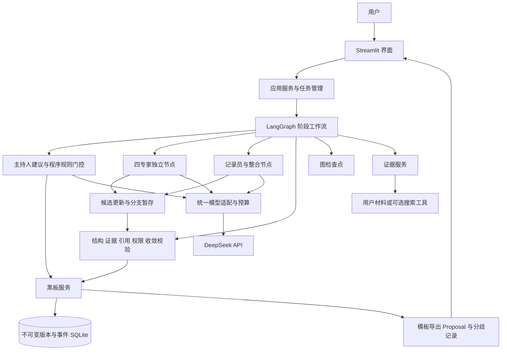
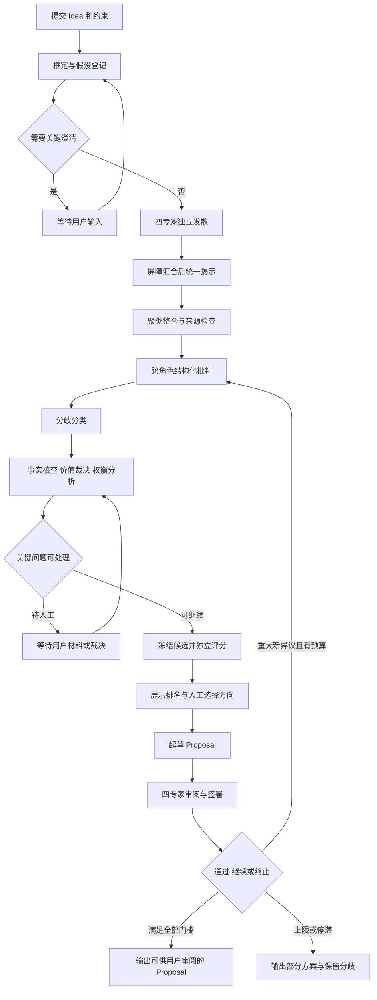

# 基于黑板与阶段化协作的多智能体软件创意分析与方案论证系统

## 软件工程项目实践设计报告

| 项目 | 内容 |
| --- | --- |
| 文档版本 | v2.0，依据教师反馈重构 |
| 编制日期 | 2026年11月5日 |
| 文档状态 | 后续开发基线，尚未实现或完成实验验证 |
| 项目简称 | SE-Agents |
| 项目定位 | 将初步软件 Idea 转化为有依据、有取舍、保留分歧的 Proposal |
| 首批用户 | 课程项目小组及内部讨论人员，暂按本地单用户工具实现 |
| 核心机制 | 结构化黑板、独立发散、结构化批判、分歧路由、评分与签署 |
| 技术基线 | Python 3.11、LangGraph、Pydantic、Streamlit、SQLite、DeepSeek API |
| MVP 角色 | 产品经理、用户研究员、技术架构师、质疑者；程序主持与记录 |
| 完整课程版角色 | MVP 四专家，加主持人 Agent、记录员/整合者 Agent |
| 第一版交付 | 本地原型、Proposal、证据与分歧记录、运行日志、测试及实验结果 |

> 本报告中的状态、接口、阈值与预算属于拟实现设计；效果和性能需在开发后验证。所有示例均为机制说明，不代表已完成真实模型讨论、调研或用户验证。

## 摘要

本项目设计一个面向软件工程前期决策的多智能体协作系统。用户提交初步软件创意，系统组织不同专业视角独立产生观点，利用共享黑板保存假设、候选方案、论点、证据、异议、立场和决策，通过结构化批判、分歧分类、加权评分及方案签署形成 Proposal。

系统的核心问题是如何让发散产生有价值的差异，让收敛遵循可核对的机制。为减少锚定和从众，独立发散阶段向各专家提供相同冻结输入，不提供同阶段其他专家的结果；为避免虚假共识，所有立场须有理由，条件赞同须有可验证条件，重大异议不能被平均分覆盖。事实分歧进入证据核查，价值分歧交由用户裁决，权衡分歧通过显式评分与取舍处理。终止与通过分开判定，达到轮次上限或停滞时仍输出部分结果与未决事项。

系统采用 LangGraph 编排状态流程，以 DeepSeek 提供模型推理，以 SQLite 保存不可变黑板版本、任务与调用记录。项目先实现四专家和程序主持、记录的最小闭环，再增加主持人、记录员 Agent 及搜索能力。通过基线对比和机制消融，评价方案质量、分歧处理、证据充分性与运行成本。

**关键词：** 多智能体；黑板架构；软件创意分析；方案论证；独立发散；机制化收敛；LangGraph；DeepSeek

## 1. 反馈分析与设计调整

### 1.1 教师建议带来的核心变化

教师反馈强调：项目难点在于“发散有质量、收敛有机制”。原 v1.0 侧重“需求分析→架构设计→测试分析→评审返工”，更适合需求相对确定后的工作；本版将主问题前移到 Idea 的澄清、方向比较与方案论证。

| 设计方面 | v1.0 | v2.0 开发基线 |
| --- | --- | --- |
| 输入 | 相对明确的软件需求 | 初步 Idea、目标、约束、可选证据 |
| 主要对象 | 需求、设计、测试产物 | 假设、候选方案、论点、异议、立场、决策 |
| 协作结构 | 顺序分工与评审 | 黑板＋主持人＋阶段化讨论 |
| 发散机制 | 需求角色先行，后续角色接收其结果 | 四专家读取同一冻结输入，独立生成后统一揭示 |
| 批判机制 | 末端质量评审 | 强制跨角色批判及持续存在的质疑者 |
| 收敛机制 | 问题修复后评审通过 | 分歧分类、证据门槛、评分、人工选方向、版本化签署 |
| 核心输出 | 需求与设计分析报告 | Proposal＋未决问题＋保留分歧＋决策依据 |
| 主要框架 | 暂按 AutoGen 0.2 | 优先采用 LangGraph；AutoGen/AG2 作为可选替代 |
| 测试分析角色 | 第一版核心角色 | 后续需求细化阶段扩展，不占用首批专家名额 |

### 1.2 保留与调整原则

保留原设计中的结构校验、来源追踪、版本管理、预算控制、错误恢复和实验评价。需求清单、模块概要、验收思路仍可作为 Proposal 的工程附件，但不再用它们代替候选方向讨论。

本项目暂按“课程小组内部使用工具”设计：默认看阶段进度与结果，可展开查看结构化讨论。实时观看全文聊天、多人在线投票和商业产品部署不纳入第一版。

## 2. 项目目标、范围与研究问题

### 2.1 项目目标

1. 将模糊 Idea 转化为清楚的问题、目标用户、约束与可验证假设。
2. 从产品、用户、技术与质疑四个视角独立生成观点和候选方向。
3. 合并相似观点时保留来源和少数意见，不通过摘要抹掉分歧。
4. 使专家对他人观点提出有理由的赞同、反对或有条件赞同。
5. 对事实、价值和权衡三类分歧采用不同处理路径。
6. 形成评分可解释、异议可追踪、签署针对具体版本的 Proposal。
7. 在无法收敛时保留诚实的部分结果，不伪装成完全共识。

### 2.2 核心研究问题

- 独立发散相较共享上下文顺序讨论，是否增加有效且不同的候选方向？
- 强制质疑和分歧分类是否帮助发现关键假设与重大风险？
- 评分、条件检查和签署能否降低“看起来同意，实际未解决”的虚假共识？
- 这些质量收益对应多少调用次数、Token、时间和人工介入成本？

### 2.3 范围分层

| 层次 | 必需能力 |
| --- | --- |
| MVP | 四专家、结构化黑板、框定、独立发散、聚类、批判、分歧分类、一轮评分、人工选方向、Proposal、四专家签署 |
| 完整课程版 | 主持人及记录员 Agent、最多两轮修订、立场变化、停滞检测、恢复、实验模式 |
| 后续增强 | 搜索与来源核查、设计师、商业/市场分析 Agent、多模型对比、更多工程附件 |

MVP 也保留程序主持与记录，并有一次批判后的局部修正机会；无需在首个版本就启用八种模型角色。完整课程版的开发基线为六种角色，设计师与商业/市场角色按需扩展。

### 2.4 边界

- 单用户、本地应用，同时只运行一个讨论任务；独立发散内部可并发调用模型。
- 中文 Idea 输入，上限默认 10,000 字符；支持 UTF-8 `.txt`、`.md`，文件上限 1 MiB。
- 讨论并行不等于多项目并行；默认模型请求并发数为 2，单次发散仍包含四个逻辑分支。
- 搜索不可用时不能自动验证事实；争议保留为待核查，必要时停止推荐。
- 不把模型生成的用户画像当成真实访谈，不将商业预测或评分当成客观事实。
- 不自动生成、执行或部署被讨论的软件，不开展付费市场调研或联系真实用户。

## 3. 用户场景与功能需求

### 3.1 主要场景

| 场景 | 用户操作 | 系统结果 |
| --- | --- | --- |
| UC-01 | 输入“想做一个帮助大学生预约自习空间的软件” | 澄清用户、问题、目标和限制，登记假设 |
| UC-02 | 启动讨论 | 四专家基于同一框定独立生成，结束后统一揭示 |
| UC-03 | 查看候选方案 | 展示聚类来源、差异、批判与分歧 |
| UC-04 | 回答问题或选择方向 | 保存人工决策与原因，更新后续流程 |
| UC-05 | 查看打分与分歧 | 展示各角色原始分、汇总、条件和保留意见 |
| UC-06 | 导出结果 | 获得 Proposal、未决事项、立场和决策链 |
| UC-07 | 取消、恢复、查看历史 | 从有效提交点继续，保留此前版本与调用记录 |

### 3.2 功能需求

`SYS-Fxx` 是本系统需求编号；讨论对象的条目采用其他编号体系。

| 编号 | 功能 | 优先级 | 验收行为 |
| --- | --- | --- | --- |
| SYS-F01 | Idea 与运行管理 | P0 | 保存原文、目标、约束、配置；输入修改产生新运行 |
| SYS-F02 | 结构化黑板 | P0 | 存储观点、方案、假设、异议、立场、决策和版本 |
| SYS-F03 | 独立发散 | P0 | 各角色只见同一初始快照和自身提示词；输出提交后统一揭示 |
| SYS-F04 | 去重与聚类 | P0 | 保留成员、来源与差异；无声丢弃观点会被检查发现 |
| SYS-F05 | 跨角色批判 | P0 | 四专家均完成；覆盖他人观点；质疑者检查高风险假设 |
| SYS-F06 | 分歧分类与路由 | P0 | 事实、价值、权衡及混合问题进入对应处理路径 |
| SYS-F07 | 评分与方向选择 | P0 | 保存逐维分数、理由、权重、缺失值与用户选定方向 |
| SYS-F08 | Proposal 与签署 | P0 | 覆盖规定章节，四专家对同一候选版本审阅并表态 |
| SYS-F09 | 人工介入 | P0 | 关键澄清、价值裁决、方向选择可暂停并恢复；不以沉默代替同意 |
| SYS-F10 | 收敛与终止 | P0 | 共识、停滞和硬上限分别计算；终止不自动等同通过 |
| SYS-F11 | 追踪与导出 | P0 | Proposal 可追溯至候选、论点、来源与决策；导出 Markdown/JSON |
| SYS-F12 | 预算与失败恢复 | P0 | 有界调用、原子预留、幂等提交、取消和显式恢复 |
| SYS-F13 | 立场变化与版本展示 | P1 | 展示由什么证据或修改导致角色改变立场 |
| SYS-F14 | 主持人/记录员 Agent | P1 | 主持建议及整合内容通过程序验证后生效 |
| SYS-F15 | 搜索与证据核查 | P2 | 来源、日期、摘录位置、支持/反驳关系均可追踪 |
| SYS-F16 | 实验与消融 | P1 | 固定案例、协议和预算条件，输出原始指标 |

P0 构成 MVP 必需能力；P1 纳入完整课程版；P2 属于增强项。搜索尚未完成时，通过用户材料和“待核查”状态保持事实边界。

### 3.3 非功能需求

| 类别 | 设计要求 |
| --- | --- |
| 可追踪 | 角色、输入快照、任务、提示词、来源、输出、评分、决策可关联 |
| 发散隔离 | 同阶段同角色分支仅访问被批准的输入投影，不共享聊天历史 |
| 一致性 | 更新经 Schema、引用与权限检查，黑板版本不可变 |
| 可复核 | 保留配置与响应；不承诺同参数输出逐字一致 |
| 可控性 | 轮次、调用、Token、执行时间、证据查询均受约束 |
| 可用性 | 工作线程执行任务，界面可查看状态、回答与请求取消 |
| 密钥管理 | 密钥从环境变量读取，不进入提示词、数据库、日志或导出 |
| 可测试 | 不联网的模拟模型可覆盖隔离、分歧、签署、停滞与恢复路径 |
| 性能目标 | 本机 100 次以内历史运行的列表与详情打开目标小于 2 秒；模型耗时独立记录，完成后实测 |

## 4. 总体架构与技术选型

### 4.1 总体架构



### 4.2 黑板作为唯一业务事实来源

黑板保存已提交的结构化业务状态；原始模型响应是候选输入，不会直接成为事实。角色读取阶段快照的投影并返回候选更新，统一通过校验后提交。所有决策、排名和签署均绑定明确版本。

讨论历史只作为审计日志保存，不整体传给后续 Agent。每阶段提供当前有效条目、相关证据和必要的轮次摘要；摘要必须引用原条目，不能替代原始内容，也不能省略仍开放的重大异议。

### 4.3 主持人与程序的权限划分

主持人 Agent 提议澄清问题、检查偏题、解释分歧、建议是否继续与下一任务。程序规则负责允许的状态迁移、轮次、预算、角色覆盖、共识计算和终止条件。

主持人不能自行关闭他人的重大异议、改变用户权重、伪造人工批准或绕过未签署状态。用户决定业务偏好、方向和可接受风险；程序执行确定性规则。

### 4.4 框架选择

教师最新建议允许 LangGraph。本项目改用其作为首选，原因是主流程包含状态、并行分支、汇合、循环和人工暂停，显式图结构更容易对应本设计。LangGraph 官方说明其支持共享状态、节点和边构成的工作流，也支持确定性步骤与模型步骤混合；本项目的角色、评分与共识规则仍需自行实现。[LangGraph 概览](https://docs.langchain.com/oss/python/langgraph/overview)

独立发散采用图分支与汇合，并为并行结果定义显式合并规则，避免并发覆盖同一状态字段。[LangGraph Graph API](https://docs.langchain.com/oss/python/langgraph/graph-api)

AutoGen/AG2 保留为课程要求变化时的适配备选，不在第一版同时引入两种编排框架。若老师后续明确要求某框架，再以决策记录调整实现，而非重写业务协议。

### 4.5 技术与版本策略

| 技术 | 用途 |
| --- | --- |
| Python 3.11 | 业务服务、节点与校验 |
| LangGraph | 状态图、分支汇合、循环与人工暂停 |
| Pydantic | Agent 输出、黑板条目与更新协议验证 |
| Streamlit | 单用户本地交互与过程展示 |
| SQLite | 黑板、任务、事件、评分、签署和调用记录 |
| DeepSeek API | 可配置的模型推理服务 |
| pytest | 业务规则、工作流与恢复的确定性验证 |

M0 阶段创建隔离环境，确认这些组件的兼容版本，生成精确依赖锁与版本决策记录。图持久化所需适配包同样锁定，不在文档中伪造尚未验证的精确版本。DeepSeek 模型名称与特有参数在真实接入前确认；API Key 只从环境变量读取。

## 5. 角色设计与实施分层

### 5.1 专家角色

| 角色 | 核心职责 | 必须检查 | 不得越界 |
| --- | --- | --- | --- |
| 产品经理 `pm` | 问题定义、价值主张、范围和优先级 | 是否解决明确问题；MVP 是否过大 | 不把商业偏好当成用户已决定事项 |
| 用户研究员 `user` | 用户、场景、痛点与验证计划 | 痛点证据是否真实；替代做法是什么 | 不虚构访谈、问卷或用户行为事实 |
| 技术架构师 `tech` | 实现方式、复杂度、依赖、成本和技术风险 | 数据来源、权限、约束、可验证的可行性 | 不把估计当成已实测性能或确定成本 |
| 质疑者 `devil` | 挑战关键假设、寻找反例和失败路径 | 最脆弱假设、重大风险、方案淘汰条件 | 不为反对而编造证据；不能无依据否决全部方案 |

四专家均参与发散、批判、评分和签署。不同提示词与独立上下文能够减少部分锚定，但不能消除同一模型的相关性错误。多模型是后续对比变量，不是第一版的必需条件。

### 5.2 流程角色

| 角色 | MVP | 完整课程版 |
| --- | --- | --- |
| 主持人 `moderator` | 程序模板与规则控制，必要问题来自专家候选 | 增加模型节点，提出框定、分类及进展判断建议；程序门控 |
| 记录员/整合者 `scribe` | 精确去重、用户确认聚类或透明规则合并；模板组装 Proposal | 增加模型聚类与整合能力，提交映射和草案；统一校验 |

MVP 不强求程序自动准确完成语义聚类：不确定的近似观点先保留，必要时由用户合并。不能为了减少候选数直接丢弃条目。

### 5.3 可选角色

设计师用于体验与交互复杂的 Idea；商业/市场分析 Agent 用于有商业目标且具备来源材料的 Idea。商业模式章节在课程项目中可写“非商业用途＋资源与维护方式”，不得强制生成定价。

新增角色会改变评分与共识分母，必须作为新运行配置冻结，不允许讨论到一半增加支持角色来提高共识率。

### 5.4 通用输出约束

每个角色只返回结构化 JSON。观点必须包含作者、目标条目、理由、来源或假设依据；没有证据可以表达推测，但必须标注。角色不能为其他角色签署，不能直接修改他人观点，不能将“没有回复”计为赞同。

## 6. 阶段流程与状态机

### 6.1 主流程



用户改变目标或关键约束时重新框定。若只是补充当前争议的证据，则回到对应处理阶段。所有受影响的评分和签署失效，不复用旧结论。

### 6.2 阶段契约

| 阶段 | 输入 | 退出条件 |
| --- | --- | --- |
| 框定 `frame` | 原 Idea、用户目标、约束 | 有问题定义、核心假设；阻断性歧义已回答或明确接受假设 |
| 发散 `diverge` | 同一冻结框定投影 | 四角色均提交合法输出，阶段屏障完成 |
| 整合 `cluster` | 全部发散结果 | 每条观点都有保留、归并或明确退役去向 |
| 批判 `critique` | 候选、原观点、假设与来源 | 四角色完成跨角色审查，质疑者检查关键假设 |
| 分歧处理 `resolve` | 异议与类别 | 处理完成，或进入等待输入/部分结果，不假定解决 |
| 评分 `score` | 冻结候选、权重与尺度 | 四角色评分齐全且版本一致，或标记评分不足 |
| 选方向 `select` | 分数、证据、风险与保留分歧 | 用户明确选择，或按事先显式授权的规则选择 |
| 起草 `draft` | 选择方向、决策、有效证据 | Proposal 各章节齐全且可追溯 |
| 签署 `signoff` | 同一 Proposal 哈希及依赖快照 | 四角色有效表态，程序计算通过与否 |
| 导出 `export` | 冻结快照 | 输出文件与该快照一致 |

MVP 默认要求用户明确选择方向；为批量实验，可以在运行前固定自动选择策略并记录为实验配置，不伪造“用户已选择”。

### 6.3 独立发散的实现规则

1. 控制器创建 `divergence_input_hash`，冻结 Idea、已确认事实、目标、约束、共同澄清与角色任务。
2. 四个分支分别创建无共享聊天记忆的模型会话，不传入其他分支输出；仅角色提示词不同。
3. 每个角色最多提交三个有实质差异的方向或观点，允许说明“信息不足”，不强迫凑满数量。
4. 分支只写自身暂存区，使用任务局部编号；汇合时由程序分配全局编号并维护映射。
5. 四分支全部合法后统一揭示；失败时有限重试，不能以空分支冒充已完成。
6. 并发槽不足时分批执行，仍保持隔离与统一揭示。物理并发不是独立性的充分条件。
7. 失败无法恢复时输出部分结果，不能用剩余角色计算“全部专家共识”。

LangGraph 共享状态本身不保证提示词隔离。输入构建器必须显式投影，模型适配层只接收投影结果；不将完整图状态直接序列化进提示词。

### 6.4 聚类与批判规则

聚类结果包含 `cluster_id`、成员观点、共同点、差异和候选方案。合并只建立关系，不删除原观点。被排除的候选必须有原因，涉及价值选择的排除需用户裁决或既有明确约束。

每位专家至少审查两个不同作者的实质观点；材料不足时审查所有可用的他人观点并说明不足。质疑者另须列出最关键的失效条件及验证方法；未发现重大缺陷时也要给出检查过的假设和理由，不编造缺陷以满足数量指标。

批判记录必须指向 `claim/assumption/option` 等具体条目，给出 `agree/oppose/conditional`、理由及依据。只写“同意”“值得关注”不算完成批判。

### 6.5 讨论轮次定义

`round=0` 为初始框定、发散、整合、批判、处理、评分、起草与签署。后续一次完整“批判→处理→必要重评分→修订→重新签署”为一轮修订，默认最多两轮。

不是每个图节点、每条消息或网络重试都增加讨论轮次。MVP 限制为一轮初始讨论及一次有界修正；完整课程版启用最多两轮修订。

## 7. 分歧分类与处理机制

### 7.1 分类规则

| 类型 | 判定依据 | 处理路径 | 示例 |
| --- | --- | --- | --- |
| 事实性 | 可通过外部资料、实验或用户材料核查 | 证据服务；无工具时请求材料或保留待核查 | 学校是否提供预约接口 |
| 价值取向 | 取决于偏好、伦理、商业目标或利益排序 | 用户裁决并记录原因 | 优先便利学生还是便于管理 |
| 权衡性 | 多个可行目标间取舍 | 相同尺度评分、敏感性检查及显式取舍 | 集成成本与使用便捷性 |
| 混合型 | 同时含事实、价值和权衡 | 拆分子问题，分别处理 | 是否为了提高出勤率接入位置数据 |

类别由专家或主持人建议，程序检查处理责任与状态。存在分类争议时保留记录，不以主持人的单次自然语言判断当作已解决。

### 7.2 事实与证据

证据可来自用户材料或后续搜索工具，记录来源 URL/文件、标题、访问日期、内容片段或定位、适用范围，以及支持/反驳哪些论点。相关不等于支持，来源相同的转述也不等于独立证据。

假设验证状态为 `unverified/supported/refuted/inconclusive`；用户接受按假设推进另用 `acceptance_status` 记录。用户接受一个假设不等于该事实已被验证。

事实来源相互冲突时登记反证和适用时间，必要时请求人工核查。第一版不凭模型“确信程度”给出真实概率，不把搜索结果数量作为真实性评分。

搜索未启用时，非阻断性事实进入未决清单；影响方案可行性的关键事实未验证且无明确可接受的条件方案时，不能输出无条件推荐。

### 7.3 价值与人工介入点

- **H1 框定：** 关键用户、目标、权限或约束不清时暂停。
- **H2 裁决：** 价值分歧或重大风险接受问题必须由用户决定。
- **H3 选方向：** 展示排名和分歧后明确选定；不默认第一名即获批准。
- **H4 最终审阅：** 输出是供用户审阅的建议；是否接受 Proposal 单独记录。

裁决保存选项、理由、操作者、时间和影响条目。无回答不继续依赖该决定的阶段。预算时间不包含等待人工的时长。

### 7.4 异议生命周期

`open → in_progress → pending_verification → resolved` 为主要路径，另有 `needs_evidence/needs_human/retained/dismissed`。

- 提出修改的角色只能申请复核，不能自己关闭其他角色异议。
- 复核需给出证据或修改引用，由原提出者或指定非责任审查角色表态，程序检查记录完整性。
- `dismissed` 需要说明为何不适用；重大异议若提出者仍不同意，进入人工裁决，不被静默驳回。
- `retained` 表示保留分歧，不等于解决；重大保留分歧阻止“充分收敛”标记。
- 同一问题跨轮次沿用编号；重述不算新增进展。

## 8. 评分、共识与签署

### 8.1 评分维度与方向

默认权重在评分前向用户展示并冻结，可按项目目标调整；改变权重会使旧排名失效。

| 维度 | 权重 | 1 分 | 3 分 | 5 分 |
| --- | --- | --- | --- | --- |
| 用户价值 | 0.30 | 问题不清或收益弱 | 有合理需求假设 | 关键需求有较充分依据、收益明确 |
| 技术可行性 | 0.25 | 关键依赖不可得 | 存在可处理的不确定性 | 关键路径清楚且有依据 |
| 成本可承受性 | 0.15 | 超出预算/维护能力 | 基本可承受但有压力 | 开发和维护成本均较可控 |
| 差异化与场景适配 | 0.15 | 相对现有做法无清楚优势 | 对目标场景有一定改进 | 明确优势且有对比依据 |
| 风险可控性 | 0.15 | 重大风险无处理路径 | 有缓解方案但需验证 | 主要风险有可执行控制措施 |

所有维度均为“越高越好”。成本和风险不得直接用金额或风险大小正向累加。权重非负且总和为 1；评分必须附理由、证据/假设和适用条件。

### 8.2 汇总与缺失值

设角色为 `r`、候选为 `o`、维度为 `d`，评分 `s[r,o,d]` 在 1—5 之间，默认四专家等权：

```text
S[r,o] = Σ_d w[d] × s[r,o,d]
S[o]   = (Σ_r S[r,o]) / N
```

保存逐维原始分、角色总分、平均分及角色分歧范围。未知情况用 `null` 表示，不用 3 分填补；缺必需维度或角色评分时，该方案标为 `insufficient_scoring`，不通过缩小分母生成正式排名。可以展示已有评价，但必须标明不完整。

总分只用于辅助比较，不覆盖不可满足的硬约束、重大异议或缺失证据。平均分相近、分歧大或证据不足时，应呈现候选并请求用户选择。用户可选择非最高分方案并记录原因。

对前两名进行简单敏感性检查：将各权重分别上下调整 0.05，非负并重新归一化，报告这些预设扰动下是否换位。该检查只反映指定扰动，不证明排名对所有权重都稳健。

### 8.3 立场与共识率

每个角色在评分任务中同时对冻结候选记录 `support/conditional/oppose/abstain` 及理由；与此前批判立场不同的，说明变化原因。条件赞同还需条件编号、验证责任与当前状态。只有条件已满足且有核验记录，才计入有效支持。

```text
共识率 C[o] = 有效支持该候选的专家数 / 本次运行固定专家数
默认候选共识阈值 = 0.75（四专家中至少三位有效支持）
```

缺席、输出失败、弃权及条件未满足均不计支持，分母不变。主持人与记录员没有专家投票权，不能通过赞同增加分子。

共识率达到阈值仅说明“可进入起草/继续论证”，不能据此判定最终 Proposal 通过。只要仍有重大异议，就保留并处理；三对一不等于少数人的问题不重要。

### 8.4 Proposal 签署

签署包含 `role`、`proposal_hash`、`board_revision`、`approve/conditional/reject`、理由、条件和异议引用。四专家必须审阅同一 Proposal 内容哈希和依赖快照。旧版本签署不能沿用；记录员无权代签。

签署开始前创建不可变的 `review_snapshot_id`。这里的 `board_revision` 指该审阅快照的黑板版本，不是写入签署事件后的最新版本。签署以附加记录保存；单纯新增签署不会使此前签署失效。若 Proposal、依赖内容或相关异议发生变化，则废止本次审阅快照并重新签署，避免签署动作本身造成版本互相失效。

完整课程版允许依据更新后的证据改变立场，但每次改变必须记录原因。重大修改使签署失效并重新征求四专家审阅，不能只询问此前反对者。

### 8.5 最终通过门槛

同时满足以下条件，才能标记 `completed` 和 `sufficiently_converged`：

1. 必需阶段与四专家任务全部完成，结构、引用、权限、快照一致性校验通过。
2. 选定方向符合硬约束，人工方向选择和必要价值裁决有有效记录。
3. 候选共识达到阈值，且无未解决的重大异议和阻断性问题。
4. 四专家对最终版本均 `approve`，或 `conditional` 的全部条件已核验满足；不存在有效 `reject`。
5. 未验证的非阻断性事实、低严重度异议和必要限制在输出中明确列出。

这里的“通过”表示讨论结果满足本系统流程要求。用户是否接受 Proposal 独立记录为 `not_reviewed/accepted/changes_requested`，不能由 Agent 代填。

## 9. 终止与进展判定

### 9.1 终止不等于通过

| 情况 | 行为 | 结果 |
| --- | --- | --- |
| 全部门槛满足 | 冻结并导出 | completed |
| 连续两轮无实质进展 | 停止自动争论，输出原因和未决项 | partial，除非本来已满足全部通过条件 |
| 连续两轮无新增异议 | 触发收敛检查，仍检查旧异议和签署 | 不单独构成通过条件 |
| 达到轮次、调用、Token 或时间上限 | 不启动新模型任务 | partial |
| 价值问题待决定 | 暂停 | waiting_input |
| 关键事实待材料 | 暂停或按用户要求输出部分结果 | waiting_input 或 partial |
| 无法恢复的格式、配置或网络错误 | 保留已提交内容 | failed |
| 用户取消、进程中断 | 停止推进，保留历史 | cancelled 或 interrupted |

### 9.2 实质进展

进展由结构化差异计算，包括：新增有效证据、经复核解决异议、补足关键条件、明确人工裁决，以及实质改变方案和相关风险的修订。纯文字重述、重复异议、仅修改分数或无依据立场变化不算进展。

主持人可解释“为什么有/无进展”，但程序依据事件和内容映射计算计数器。语义去重不确定时保留人工复核，不把模型自报的新观点数当作事实。

### 9.3 运行状态

`queued/running/waiting_input/completed/partial/failed/cancelled/interrupted` 为生命周期状态，`frame/diverge/cluster/critique/resolve/score/select/draft/signoff/export` 为独立阶段字段。恢复位置与等待原因显式持久化。

## 10. 黑板数据模型与更新协议

### 10.1 黑板逻辑结构

以下是业务结构示意，具体 Pydantic 字段在 M1 实现；并非完整可运行代码。

```python
class Blackboard(TypedDict):
    run_id: str
    revision: int
    idea: dict
    framing: dict
    sources: list[dict]
    evidence: list[dict]
    assumptions: list[dict]
    claims: list[dict]
    clusters: list[dict]
    options: list[dict]
    objections: list[dict]
    stances: list[dict]
    scores: list[dict]
    scoring_config: dict
    decisions: list[dict]
    open_questions: list[dict]
    proposal_draft: dict | None
    signoffs: list[dict]
    round: int
```

图运行状态使用轻量 `board_ref`、阶段、轮次、分支任务引用和恢复信息，完整黑板由服务按版本读取。这样减少图检查点与业务数据双份修改造成的不一致；模型不会直接收到整个黑板。

### 10.2 编号与来源

| 对象 | 编号前缀 | 关键字段 |
| --- | --- | --- |
| 来源 | SRC | 原文/URL、位置、获取时间、来源类型 |
| 假设 | ASM | 内容、重要性、验证状态、接受状态、证据、影响方案 |
| 论点 | CLM | 内容、作者、依据类型、来源/假设引用、适用范围 |
| 聚类 | CLS | 成员观点、共同点、差异、合并依据 |
| 候选 | OPT | 价值主张、范围、实现方式、关键依赖、论点与假设引用 |
| 证据 | EVD | 支持/反驳目标、来源、摘录定位、适用时间与限制 |
| 异议 | OBJ | 目标、类别、严重度、作者、理由、状态、处理与复核引用 |
| 立场 | STN | 角色、候选版本、立场、理由、条件、前次立场与变化原因 |
| 评分 | SCR | 角色、候选版本、权重版本、各维分、依据 |
| 决策 | DEC | 类型、选项、选择、理由、操作者、影响对象 |
| 问题 | QST | 内容、阻断性、责任方、回答来源、状态 |
| 方案 | PRP | 章节、方向引用、依据引用、版本与内容哈希 |
| 签署 | SIG | 角色、方案哈希、审阅快照、结论、理由、条件 |

编号在运行内稳定，所有历史引用带对象版本。修改增加版本，退役保留记录，不复用编号。模型临时编号在汇合时映射到全局编号。

### 10.3 论点依据类型

`explicit` 表示输入明确给出，`evidence_based` 表示有外部/用户材料支持，`inferred` 表示分析推导，`assumed` 表示假设。来源存在性由程序校验，是否语义支持仍需审查。评分理由与 Proposal 的关键主张也必须使用该依据体系。

### 10.4 更新协议

所有写入通过 `BlackboardPatch`，至少包含：

```json
{
  "schema_version": "2.0",
  "run_id": "run-example",
  "task_id": "task-tech-critique-0",
  "base_revision": 7,
  "role": "tech",
  "stage": "critique",
  "operations": [
    {
      "op": "add",
      "entity_type": "objection",
      "temp_id": "tech-local-1",
      "payload": {
        "target_ref": "OPT-002@1",
        "category": "factual",
        "severity": "major",
        "reason": "方案依赖学校预约接口，目前没有接口开放证明。",
        "evidence_refs": [],
        "assumption_refs": ["ASM-002@1"],
        "suggested_action": "请用户提供接口材料；无材料时保留待核查。"
      }
    }
  ]
}
```

`base_revision` 必须匹配当前提交基线；并行阶段各 Patch 先暂存，屏障节点在同一冻结输入上校验并统一合并。不得用后完成分支覆盖先完成分支。

角色只能新增自身观点、提出异议和立场；对他人观点的修正采用引用与新版本建议。合并、全局编号、状态变更和版本推进由黑板服务执行。

### 10.5 校验清单

校验 Schema、编号唯一、引用存在、角色权限、分支输入哈希、作者归属、聚类覆盖、反对理由、条件完整性、评分范围、权重和、角色覆盖、签署哈希和依赖新鲜度。

内容通过后才提交；失败留在当前任务，有界修正，不推进阶段。格式有效不等于观点正确，语义质量通过专家批判和人工实验评价。

### 10.6 变更与失效传播

| 变更 | 必需处理 |
| --- | --- |
| 目标、用户或硬约束改变 | 重新框定；受影响候选、评分、选择和签署失效 |
| 候选内容、关键假设或证据改变 | 重新批判并刷新相关处理；对应评分和立场失效，重新确认方向 |
| 权重或评分尺度改变 | 四专家重新评分，排名和方向选择重新确认，相关 Proposal 与签署失效 |
| 新增或重开重大异议 | 暂停通过，回到处理阶段；当前审阅快照失效 |
| 仅 Proposal 表述修改 | 内容哈希改变，四专家重新签署；未改变候选及依据时可保留评分 |
| 只增加签署、审计或导出记录 | 不改变被审阅内容，不使其他有效签署失效 |

失效是状态标记而非删除历史。第一版对难以判断的语义变更采取保守刷新，并将刷新原因展示给用户。

## 11. 持久化、并发与恢复

### 11.1 SQLite 核心表

| 表 | 用途 |
| --- | --- |
| projects、runs | 项目、冻结配置、生命周期、阶段、轮次、终止原因 |
| sources、evidence | 原始输入、回答与可核对证据 |
| board_revisions | 不可变黑板快照、父版本、内容哈希 |
| entities、entity_versions | 对象索引与版本内容，便于查询与引用 |
| tasks、branch_results | 阶段任务、输入哈希、分支暂存、幂等键、重试状态 |
| patches、commit_events | 候选更新、校验与提交记录 |
| stance_events、score_sets | 立场变化、完整评分集与权重版本 |
| decisions、signoffs | 人工和程序决策、版本化签署 |
| model_calls、events | 每次请求、用量、错误、预算和状态事件 |
| snapshots、exports | Proposal 依赖快照与导出文件 |

图检查点由锁定版本的持久化适配器管理，与业务数据库区分职责。模型调用记录保存实际 usage 和未知用量状态，不能只记成功调用。

### 11.2 并发写入与预算

仅一个运行可以活动，但内部模型请求可并发。分支不直接修改主黑板，各任务使用独立数据库连接。预算通过事务原子预留，避免两个分支同时认为余额充足；响应后结算并释放多余预留。

合并采用 `base_revision` 检查和单次事务，原子提交新版本、任务完成和事件。重复 Patch 根据幂等键返回既有提交结果。并行结果顺序按固定角色序和条目序规范化，不依赖网络完成顺序。

### 11.3 恢复语义

LangGraph 检查点支持暂停和恢复，但不能假设它与业务数据库跨库原子提交。每个提交节点保存幂等提交标识；业务已提交而图节点重放时返回既有结果，不重复创建版本。若图状态声称已完成而业务提交不存在，则回退到最后有效业务提交点并记录异常。

人工暂停节点只提出问题并等待回答，模型请求和不可逆写入放在独立节点，避免恢复时重复产生副作用。官方说明中断恢复可能从节点开头重新执行，因此必须处理幂等性。[LangGraph Interrupts](https://docs.langchain.com/oss/python/langgraph/interrupts)

进程退出后，活动运行标记 `interrupted`；用户明确恢复。成功提交的分支可以复用，输入版本变化后不能复用。网络超时不保证服务端没有处理请求，未知调用不能当作未发生或零费用。

## 12. 模型、上下文与预算

### 12.1 模型接入

使用统一客户端适配 DeepSeek，模型名称通过环境或配置注入。官方提供兼容 OpenAI 格式的 API，基础地址为 `https://api.deepseek.com`，具体模型与参数在 M0 核验。[DeepSeek API 文档](https://api-docs.deepseek.com/)

可启用 JSON Output，但仍需处理空白、截断、合法 JSON 中的错误字段及业务引用。[DeepSeek JSON Output](https://api-docs.deepseek.com/guides/json_mode/)

第一版工具由图节点和程序调用，不依赖模型自主执行 Shell、任意文件写入或无边界搜索。

### 12.2 上下文管理

- 发散投影：Idea、共同框定、目标、约束、已确认来源及自身任务。
- 批判投影：冻结候选、成员观点、关键假设、证据、需要审查的目标。
- 评分投影：统一候选、处理后的异议、评分尺度与权重；不提供同阶段其他角色的分数。
- 签署投影：精确 Proposal、关联决策和所有未解决异议。
- 轮次摘要：只描述变化并保留原条目引用；不凭摘要关闭问题。

输入超限时先减少非必要历史和分批审查；不可静默裁掉重大异议、硬约束或反证。记录每次实际投影哈希供隔离验证。

### 12.3 默认配置示意

```yaml
model:
  provider: deepseek
  base_url: https://api.deepseek.com
  name: ${DEEPSEEK_MODEL}
  api_key_env: DEEPSEEK_API_KEY
  request_timeout_seconds: 120
  max_output_tokens: 4096
  json_output: true
workflow:
  expert_roles: [pm, user, tech, devil]
  moderator_mode: agent
  scribe_mode: agent
  max_concurrent_runs: 1
  max_concurrent_requests: 2
  max_revision_rounds: 2
  max_no_progress_rounds: 2
  consensus_threshold: 0.75
  max_options_for_scoring: 3
budget:
  max_model_calls: 48
  max_total_tokens: 160000
  max_active_seconds: 1800
  max_attempts_per_task: 3
  max_schema_repairs_per_task: 1
  max_clarification_batches: 3
  max_search_calls: 0
```

这些是完整课程版初值，需通过实测调整。MVP 使用程序主持与记录，搜索默认关闭。三方案上限不允许截断丢弃发散结果：先保留全部，再根据硬约束、聚类和用户选择形成至多三个评分候选，其他方向留在归档区并说明原因；无法合理缩减时请求用户选择。

48 次是包括全部专家、主持、整合及重试的总请求预算，不保证任何输入都能用完两轮修订。必须为四专家最终签署预留必要额度；预算不足以完成下一完整阶段时停止并输出部分结果。

### 12.4 预算与错误处理

每次实际请求都计入预算，底层 SDK 隐式重试关闭或纳入统一计数。每任务最多三次请求，格式修正最多一次，包含在三次内。并发取消后尚未返回的请求继续计入已发出请求，迟到响应不得推进取消状态。

Token 使用响应实际字段并保留原始 usage，按字段语义避免重复统计；请求前预估输入并预留最大输出，误差可能导致一次请求超出软上限，不宣称严格费用封顶。未知用量单列，金额仅在配置对应模型价目后估算。

| 异常 | 行为 |
| --- | --- |
| 密钥或模型配置缺失 | 调用前拒绝，提示修正 |
| 401/403 | 不反复重试，保留失败原因 |
| 429、临时网络错误、部分 5xx | 有界退避，遵循可用提示，受统一预算控制 |
| 空白、截断、Schema 失败 | 一次有界修正机会；不提交半个产物 |
| 引用、权限、版本冲突 | 拒绝 Patch，返回可定位原因 |
| 重大事实或价值问题未解决 | waiting_input；无授权不代替用户决定 |
| 达上限、无法继续收敛 | partial，并说明原因 |
| 导出失败 | 单独重试导出，不重新运行模型讨论 |

## 13. Proposal 输出与追踪

### 13.1 模板

1. 背景与问题：原始 Idea、当前问题定义和来源。
2. 目标用户：角色、场景、痛点与已验证/待验证程度。
3. 价值主张：预期改善、替代做法和支持依据。
4. 范围：MVP、非目标、硬约束和取舍。
5. 核心功能：优先级、关键规则及初步验收指标。
6. 技术方案概要：模块、数据、依赖、风险与验证计划。
7. 商业模式或资源方式：商业目标适用时填写；课程项目可说明非商业用途。
8. 成功指标：可观测定义、数据获取方式、目标值依据。
9. 风险与关键假设：验证状态、接受状态、验证计划和失效条件。
10. 里程碑：阶段交付、依赖、验证门槛。
11. 未决问题与分歧记录：严重度、角色立场、未解决原因及下一步。
12. 决策附件：候选比较、评分、人工裁决、签署和版本。

正文应可供普通项目成员阅读；原始 JSON、提示词摘要和用量放入附件。不得虚构市场规模、访谈、定价结论和软件测试已通过的结果。

### 13.2 追踪关系

```text
原始来源/证据 → 假设与论点 → 候选方向 → 异议与处理
→ 评分和人工决策 → Proposal 章节/功能 → 版本签署
```

程序生成追踪矩阵和证据状态表，模板直接渲染已提交内容。记录员可以起草叙述，但新增关键主张必须先登记并校验，不能在导出润色时偷偷引入新结论。

### 13.3 部分结果

部分结果保留已形成的候选或草案，明确标记 `partial`、缺失阶段、未签署角色、重大异议、过期评分和停止原因。不存在草案时导出分析摘要，不用空 Proposal 冒充完整成果。

## 14. 内部服务与界面

### 14.1 服务接口约定

第一版界面直接调用 Python 服务，不增加独立 HTTP 后端。

```python
def create_project(name: str) -> Project: ...
def create_run(project_id: str, idea: str, config: RunConfig) -> Run: ...
def start_run(run_id: str) -> Run: ...
def get_run(run_id: str) -> RunDetail: ...
def get_board(run_id: str, revision: int | None = None) -> Blackboard: ...
def list_events(run_id: str, after_id: int = 0) -> list[RunEvent]: ...
def submit_answer(run_id: str, question_id: str, answer: str) -> Decision: ...
def select_option(run_id: str, option_ref: str, reason: str) -> Decision: ...
def submit_value_decision(run_id: str, request_id: str, choice: str, reason: str) -> Decision: ...
def set_proposal_review(run_id: str, proposal_hash: str, status: str, reason: str) -> Decision: ...
def cancel_run(run_id: str) -> Run: ...
def resume_run(run_id: str) -> Run: ...
def export_result(run_id: str, snapshot_id: str, format: str) -> ExportResult: ...
```

方向选择与裁决只接受当前请求及有效版本。重新启动已完成运行需创建新运行。权重变更在评分前通过配置冻结，评分后修改创建新配置版本并使相关评分/签署失效。

### 14.2 页面区域

| 区域 | 内容 |
| --- | --- |
| Idea 与框定 | 原文、目标用户、约束、问题和假设 |
| 阶段进度 | 当前阶段、角色完成情况、调用/Token/时间、取消 |
| 发散结果 | 汇合后展示四角色观点，显示独立输入版本 |
| 候选黑板 | 聚类、候选、来源、差异、反对与条件 |
| 分歧工作台 | 分类、严重度、证据、责任方、待人工裁决 |
| 比较与选择 | 原始分、加权结果、缺失、敏感性与人工选择 |
| Proposal | 草案、未决事项、四角色签署、用户审阅状态 |
| 历史与导出 | 快照、立场变化、运行记录、Markdown/JSON 下载 |

默认展示结构化结果和简短阶段更新，原始模型消息可展开查看。独立发散阶段不向其他分支发布已完成分支内容；界面也在屏障后统一揭示，避免用户介入导致同阶段输入不一致。

界面重跑不重新创建工作线程；应用级任务管理器与数据库活动任务约束防止重复启动。工作线程不直接调用 Streamlit UI API。

## 15. 示例：校园自习空间使用助手

### 15.1 初始 Idea

> 做一个帮助大学生找到并预约自习空间的软件，希望减少找座位时间，课程项目开发周期有限。

### 15.2 发散与候选

| 角色 | 独立观点示例 |
| --- | --- |
| 产品经理 | 优先做空闲空间聚合，缩小预约功能范围 |
| 用户研究员 | 用户可能更需要可靠开放信息；需验证痛点频率与替代做法 |
| 技术架构师 | 直接接入学校预约系统存在权限与接口依赖，可比较手工维护和官方接入 |
| 质疑者 | 信息不及时可能比没有信息更糟；没有数据更新机制时价值主张可能失效 |

整合形成两个候选：OPT-001“开放信息查询与收藏”；OPT-002“接入学校系统的完整预约助手”。观点都保留，不强行整合成一个大而全系统。

### 15.3 分歧处理

| 分歧 | 类型 | 处理 |
| --- | --- | --- |
| 学校是否开放接口 | 事实 | 请求官方资料；无材料则未验证 |
| 应优先学生便利还是管理员管控 | 价值 | 用户明确优先目标 |
| 功能完整与六周开发约束如何取舍 | 权衡 | 按统一标准评分，展示成本和风险 |

假设用户明确“课程演示优先，无法获得官方接口”，可以选定 OPT-001，并把“有可靠更新来源”列为验证前提；系统不能因为多数赞同而声称官方数据已经可用。

### 15.4 批判、修改与签署

质疑者提出“更新机制缺失”重大异议，技术角色提出维护责任与过期提示方案，用户角色要求开展小样本验证。修订后的 Proposal 区分“可完成的课程原型”与“尚未证实的真实使用效果”。

若更新来源仍无着落且该条件被判断为关键，最终输出条件方案或部分结果；达到讨论上限并不能把该异议标记为已解决。若条件有可核对的落实记录，四角色再对同一修订版签署。

## 16. 目录与开发计划

### 16.1 建议目录

```text
se-agents/
├── app.py
├── pyproject.toml
├── requirements.lock
├── .env.example
├── README.md
├── src/se_agents/
│   ├── config.py
│   ├── schemas/          # 黑板、Patch、来源、评分、签署、运行
│   ├── agents/           # 四专家、主持人、记录员
│   ├── prompts/          # 角色与阶段提示词
│   ├── graph/            # 节点、边、分支、屏障、人工暂停
│   ├── blackboard/       # 投影、合并、版本、权限、快照
│   ├── deliberation/     # 分类、评分、共识、签署、进展规则
│   ├── evidence/         # 用户材料、可选搜索与支持关系
│   ├── llm/              # 模型适配、预算、用量、模拟模型
│   ├── storage/          # SQLite、迁移、幂等与恢复
│   ├── services/         # 应用业务接口
│   ├── workers/          # 单运行管理、并发请求与取消
│   ├── reporting/        # Proposal 模板、追踪与导出
│   └── ui/
├── tests/
│   ├── unit/
│   ├── integration/
│   └── fixtures/
├── examples/
├── experiments/
├── docs/
└── data/                 # 本地数据库和导出，排除版本控制
```

### 16.2 里程碑

| 阶段 | 工作 | 交付与验收门槛 |
| --- | --- | --- |
| M0 兼容性 | 验证 LangGraph、模型客户端、SQLite 检查点及依赖 | 精确锁文件；模拟分支/汇合/暂停；有密钥时补真实 JSON 冒烟 |
| M1 黑板骨架 | Schema、Patch、投影、来源、版本、暂存与合并 | 无联网也可验证并发不覆盖、错误引用不提交 |
| M2 四专家 MVP | 程序主持/记录，独立发散、批判、分类、评分、人工选择、模板 Proposal 与签署 | 跑通一轮闭环和未收敛案例 |
| M3 机制增强 | 主持/记录 Agent、语义聚类建议、最多两轮修订、进展检测、立场变化 | 模型不能绕过程序门槛，保留少数意见 |
| M4 可用原型 | 界面、人工暂停、历史、恢复、快照导出、预算控制 | 完成全部 P0 验收与必要 P1 集成 |
| M5 真实验证与实验 | DeepSeek 集成，三组对比、机制消融、盲评 | 原始数据、成本、失败与局限可复核 |
| M6 可选增强与交付 | 搜索、附加角色、运行手册与演示 | 增强项不阻塞主流程交付 |

自动搜索在 M6 可选实现；M2 起即可用用户提供材料测试事实核查路径，不能将“发起搜索任务”当作已经取得证据。

### 16.3 首批开发任务

1. 建立 LangGraph 单节点和四分支模拟流程、暂停恢复演示。
2. 定义黑板、Patch、候选、异议、评分与签署 Schema。
3. 实现不可变版本、分支暂存、输入投影及幂等提交。
4. 用模拟角色验证“一份冻结输入、四份互不可见结果、统一揭示”。
5. 实现分类路由、评分缺失值、条件赞同、重大异议和签署门槛。
6. 实现程序版聚类与 Proposal 模板，再加入模型整合建议。
7. 连接实际角色提示词、DeepSeek 和界面，按验收记录验证。

无密钥时可完成模拟流程和大部分界面，不能据此宣称真实模型质量或兼容性通过。

## 17. 验收与测试

### 17.1 关键验收用例

| 编号 | 场景 | 期望结果 |
| --- | --- | --- |
| AT-01 | 空白、超限、错误编码输入 | 调用前拒绝，无模型费用 |
| AT-02 | 四角色分支先后完成 | 输入投影不包含同阶段他人输出；屏障后统一揭示 |
| AT-03 | 一个角色失败 | 有界重试；不把三角色当作四角色完成 |
| AT-04 | 两分支同时提交 | 结果不覆盖；统一合并顺序可复核 |
| AT-05 | 聚类遗漏或抹除少数观点 | 覆盖校验失败，要求补充映射或保留 |
| AT-06 | 只有“同意”或质疑者未审查关键假设 | 不算完成批判任务 |
| AT-07 | 事实分歧但无搜索/来源 | 待核查，不标记事实已验证 |
| AT-08 | 用户接受未经验证假设 | acceptance 改变，verification 不随之改为 supported |
| AT-09 | 价值分歧没有用户回答 | waiting_input，不自动裁决 |
| AT-10 | 成本/风险方向、权重不合法 | 拒绝评分；所有维度方向一致 |
| AT-11 | 缺角色或维度评分 | 不缩小分母、不用中间值填补，标记不足 |
| AT-12 | 三位支持、一位提出重大异议 | 共识率可达 0.75，但不能通过最终门槛 |
| AT-13 | 条件赞同但条件未满足 | 不计有效支持，也不算有效最终批准 |
| AT-14 | 修改 Proposal 或依次追加签署 | 内容改变需四角色重签；仅追加签署不使此前有效签署失效 |
| AT-15 | 连续两轮无新增异议但旧问题未解决 | 不伪装通过，必要时 partial |
| AT-16 | 连续两轮仅重述/改分 | 不算实质进展，触发停滞终止 |
| AT-17 | 两分支同时争用最后预算 | 原子预留只允许可负担任务，防止重复消费额度 |
| AT-18 | 重试、超时、取消和未知用量 | 请求均记录；未知不是零；迟到输出不推进取消状态 |
| AT-19 | 提交成功后图节点重放 | 幂等返回原版本，不重复产生对象或决策 |
| AT-20 | 人工暂停恢复 | 同一请求恢复，无重复模型调用或人工决策 |
| AT-21 | 导出部分结果 | 明示缺失、未签署、过期和未决问题，与快照一致 |
| AT-22 | 密钥与非法更新 | 密钥不出现在日志导出，越权 Patch 被拒绝 |
| AT-23 | 排名变化/权重变更 | 旧排名标记失效，记录版本和重新选择依据 |
| AT-24 | 用户未最终审阅 | 可交付讨论结果，但用户接受状态仍为 not_reviewed |

主要用确定性模拟模型验证控制机制，真实输出的质量通过人工评价验证。不能用模型自己给自己评分代替全部验收。

### 17.2 真实接入检查

获得 DeepSeek 使用条件后验证：JSON 结构、分支并发、评分、一次人工暂停、一次重大异议修订、四角色签署、usage 记录及预算。记录模型标识、参数、提示词哈希、依赖锁与测试日期。

### 17.3 原型交付条件

全部 P0 和 AT-01 至 AT-24 的相关机制验证通过；完整课程版实现主持/记录 Agent 与修订记录；至少一项真实 Idea 输出可供审阅的 Proposal，至少一项展示未收敛的部分结果。交付源码、锁文件、运行手册、示例、调用与版本证据。

## 18. 效果评价与对比实验

### 18.1 主实验

| 组别 | 方案 | 目的 |
| --- | --- | --- |
| A | 单 Agent 一次生成同模板 Proposal | 基础使用成本与质量基线 |
| B | 四角色共享历史顺序讨论后整合，限制轮次 | 比较普通多角色讨论 |
| C | 本设计：独立发散、黑板、批判、分类、评分、人工策略与签署 | 评价机制化协作的整体效果 |

三组使用相同模型、Idea、有效材料、目标模板和输出范围。各组获得相同预先冻结的澄清答案，不能只给 C 组额外事实。用于实验的人工选择策略在运行前制定，记录人工介入次数与时长。

### 18.2 消融

在 C 组基础上每次只改变一个因素：共享发散结果以移除独立性；以普通审阅角色替换质疑者以保持人数；移除分歧分类，采用通用处理；只按平均分选方向，取消异议/签署门槛。每种配置保留记录，失败和未达门槛也统计。

预算不足时先完成主实验和“独立发散”“重大异议门槛”两个关键消融；不承诺一次作业覆盖所有组合。

### 18.3 指标

| 指标 | 含义 |
| --- | --- |
| 有效差异方向数 | 人工确认的不同且相关的方向数；不按原始文本条数计 |
| 关键假设覆盖率 | 识别出的参考关键假设 / 参考关键假设总数 |
| 有效异议准确率 | 人工确认有效且不重复的异议 / 提出异议总数 |
| 已知风险召回率 | 命中的预标注风险 / 预标注风险总数 |
| 假共识事件数 | 标记通过时仍有重大未决、缺签署、未满足条件或把沉默计赞同的事件 |
| 分歧处理完整性 | 分类、责任、行动、证据、结论记录是否完整 |
| 证据支持率 | 有适当可核对来源的关键事实主张 / 全部关键事实主张 |
| Proposal 人工评分 | 问题清晰、用户价值、可行性、取舍解释、诚实性，各 1—5 分 |
| 运行与成本 | 完成/部分/失败比例、调用、Token、活跃耗时、人工时间、未知用量 |

无适用主张或问题时分母为零，记“不适用”；不得制造满分。不同方案合理时按共同质量标准评价，不把某个参考 Proposal 当成唯一正确答案。

### 18.4 实验规模与限制

建议选择六个 Idea（自习空间、报修、社团活动、学习互助、校园二手、简易订餐），每组重复三次，共 54 次主实验；实际次数由预算决定并如实报告。案例预先设置模糊目标、缺证据依赖、价值冲突和明显约束。

采用同模型与固定提示词版本，尽量盲评；条件允许时两人独立评分。完整流程消耗更多推理预算，质量收益不能全部归因于多角色；预算允许时补充相近 Token 预算下的单 Agent 自我修订对照。

报告单次数据、均值与范围/标准差、失败和样本量，不以小样本得出普遍结论。控制机制“没有错误通过”与实际方案“业务上合理”分别评价。

## 19. 风险、待确认与交付

### 19.1 主要风险

| 风险 | 对策 |
| --- | --- |
| 同模型角色趋同 | 独立输入、差异化职责、独立评分；后续做多模型对比 |
| 假共识与强制反对 | 需要理由与依据；有条件支持核验；质疑者可以有理由地批准 |
| 聚类抹掉反对 | 原观点不可变、映射完整性、保留差异与退役原因 |
| 摘要遗漏反证 | 开放异议强制进入相关阶段投影，摘要不能代替原文 |
| 评分产生虚假精确性 | 公开尺度、缺失值与分歧范围，保留硬约束和人工选择 |
| 事实无法核查 | 明确待验证，不把用户接受或模型自信当作验证 |
| 主持人越权 | 程序门控、权限校验、人工决策与专家签署独立 |
| 多分支超预算 | 原子预留、并发上限、阶段额度和总请求计数 |
| 图与黑板双写不一致 | 幂等提交、明确事实来源、恢复核对与事件记录 |
| 需求范围膨胀 | 先四专家 MVP，后六角色；搜索、设计师和市场角色分层实现 |

### 19.2 待确认事项

| 事项 | 本版默认 | 后续影响 |
| --- | --- | --- |
| 面向用户产品还是内部工具 | 课程小组内部工具，本地单用户 | 若产品化再讨论多人、权限、部署与交互 |
| 框架是否必须 AutoGen | 按教师最新允许项选 LangGraph | 若有强制要求调整编排适配 |
| DeepSeek 模型与费用预算 | 模型外置，未进行真实调用 | 决定并发、案例数和参数 |
| 截止日期与小组规模 | 按里程碑，不预设成员 | 决定实际排期 |
| 是否启用搜索 | 第一版关闭，接收用户材料 | 后续单独配置提供方与费用 |

默认项用于推进设计和实现，不把它们描述为用户已经确认的业务偏好。

### 19.3 交付清单

1. v2.0 设计报告、变更记录与实现中的技术决策。
2. 可运行源码、精确依赖锁、配置示例、运行手册。
3. 黑板与更新 Schema、阶段输入投影、角色提示词。
4. 独立发散、批判、分歧分类、评分与签署实现。
5. Proposal、未决事项、保留分歧、来源与决策链示例。
6. 确定性测试与真实 DeepSeek 集成记录。
7. 对比实验原始数据、评价标准、成本与局限。
8. 演示：正常收敛、重大分歧、人工裁决、停滞和故障恢复。

## 参考资料

教师反馈是本次角色、黑板及讨论流程调整的主要依据。以下官方资料用于核对框架与模型接口；评分、共识门槛和业务协议为本项目设计，查阅日期为 2026年11月5日。

1. [LangGraph：概览](https://docs.langchain.com/oss/python/langgraph/overview)
2. [LangGraph：Graph API](https://docs.langchain.com/oss/python/langgraph/graph-api)
3. [LangGraph：人工中断与恢复](https://docs.langchain.com/oss/python/langgraph/interrupts)
4. [DeepSeek：API 接入](https://api-docs.deepseek.com/)
5. [DeepSeek：JSON Output](https://api-docs.deepseek.com/guides/json_mode/)
6. [AutoGen 0.2：StateFlow 参考，作为备选编排思路](https://microsoft.github.io/autogen/0.2/docs/notebooks/agentchat_groupchat_stateflow/)

## 附录 A：开发核对表

- [ ] 发散和评分采用阶段输入隔离，不发送其他角色同阶段结果。
- [ ] 分支暂存与汇合可审计，失败角色不能被当作同意。
- [ ] 聚类保留所有观点去向及少数意见。
- [ ] 质疑者必需存在，反对和批准都需理由。
- [ ] 事实验证与接受假设分别存储。
- [ ] 价值裁决和方向选择有授权依据，沉默不算同意。
- [ ] 评分方向一致，权重和为 1，缺失不填成中间分。
- [ ] 重大异议不被多数票和平均分覆盖。
- [ ] 有条件赞同先核验条件，最终四专家签署同一版本。
- [ ] 连续无新增异议不等于旧问题已解决。
- [ ] 终止与通过分别判定，部分结果保留分歧。
- [ ] 多分支预算原子预留，重试与未知用量可见。
- [ ] 图恢复不会重复业务提交，人工节点可幂等恢复。
- [ ] 未完成真实验证前，不声称模型或 Proposal 效果通过。

## 附录 B：版本修订记录

| 版本 | 日期 | 变更 |
| --- | --- | --- |
| v1.0 | 2026-11-05 | 建立需求、设计、测试与评审的顺序协作方案 |
| v2.0 | 2026-11-05 | 根据教师反馈改为黑板驱动的 Idea→Proposal；增加独立发散、四专家与两流程角色、分歧分类、评分、共识/签署、停滞检测与人工裁决；首选框架调整为 LangGraph；重写数据协议、任务、验收和实验 |
